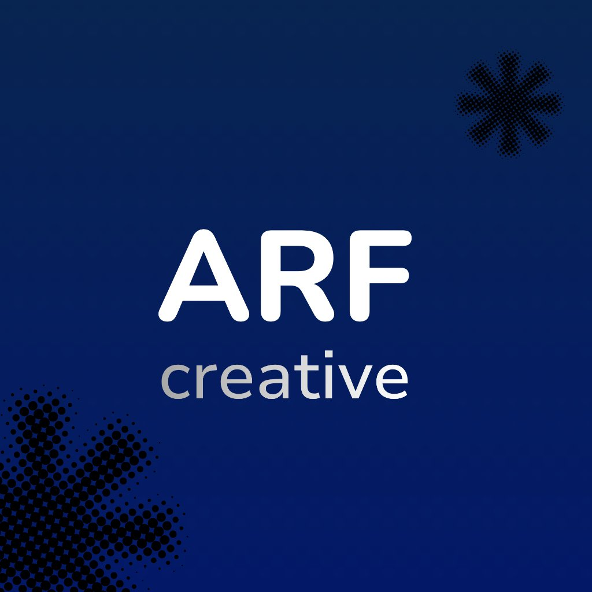

# ARF Creative : Creative Space & Dokumentasi Projek Digital

> **Website Profil & Dokumentasi Projek Resmi ARF Creative (@arf_.creative)**
> *"Creative space & process. Let's collaborate."*



---

## 📌 Tentang ARF Creative

Website ini dibangun sebagai **Creative Studio & Project Documentation Portfolio** untuk **ARF Creative (`@arf_.creative`)**. Didesain secara khusus untuk mendokumentasikan karya rancang bangun website dengan pendekatan editorial yang bersih, berani, dan bebas dari pola generik template AI.

Dibangun dengan arsitektur statis modern berbasis **React + Vite + Tailwind CSS**, siap langsung di-deploy ke **Vercel** tanpa dependensi backend atau database.

---

## 🎨 Struktur Halaman & Fitur Utama

1. **Header Studio ([Navbar.jsx](src/components/Navbar.jsx))**:
   - Menampilkan logo resmi ARF Creative (`/logo.jpg`), tautan navigasi langsung ke dokumentasi projek, serta shortcut WhatsApp & Instagram.

2. **Hero Section ([Hero.jsx](src/components/Hero.jsx))**:
   - Tipografi editorial berkarakter kuat: *"Mendokumentasikan Setiap Proses Rancang Bangun Web."*
   - Menampilkan showcase kartu artwork resmi ARF Creative dengan aksen *halftone dot starburst*.

3. **Dokumentasi Projek & Studi Kasus ([ProjectDocumentation.jsx](src/components/ProjectDocumentation.jsx))**:
   - Inti utama website yang menyajikan studi kasus mendalam untuk projek nyata:
     - **01. Aksara Dialogue** (*"Suara Publik, Ruang Dialog"*): Platform editorial opini publik independen. Dokumentasi latar belakang masalah, pendekatan tipografi ramah baca, arsitektur React, link repositori GitHub, dan live demo.
     - **02. BDG Boys Merch** (*"Streetwear & Apparel Merchandise Web"*): Katalog produk apparel lokal Bandung dengan alur pemesanan langsung WhatsApp.
     - **03. Projek Pertama Kreatif** (*"Dokumentasi & Proses Belajar Koding"*): Catatan arsip eksplorasi koding web dari nol (HTML5 semantik, CSS Grid, DOM JavaScript).
     - **04. ARF Creative Space** (*"Static Site Architecture"*): Dokumentasi arsitektur website resmi siap Vercel.

4. **Filosofi & Catatan Proses ([AboutStudio.jsx](src/components/AboutStudio.jsx))**:
   - 3 Pilar utama studio: *Dokumentasi Menyeluruh, Karakter Visual yang Otentik, dan Arsitektur Statis Modern*.

5. **Ruang Kolaborasi & Kontak ([CollabContact.jsx](src/components/CollabContact.jsx))**:
   - Jalur komunikasi langsung ke WhatsApp, Instagram (`@arf_.creative`), GitHub, dan Email dilengkapi tombol salin 1-klik.

6. **Footer ([Footer.jsx](src/components/Footer.jsx))**:
   - Identitas studio resmi dan navigasi kembali ke atas.

---

## ⚙️ Cara Menjalankan Project Secara Lokal

1. **Install Dependensi**:
   ```bash
   npm install
   ```

2. **Jalankan Server Development**:
   ```bash
   npm run dev
   ```
   Buka URL lokal yang muncul (misalnya `http://localhost:5174`).

3. **Build untuk Production**:
   ```bash
   npm run build
   ```

---

## 🌐 Deploy ke Vercel

```bash
git add .
git commit -m "feat: complete bespoke ARF Creative studio & documentation website"
git push origin main
```

Lalu hubungkan repositori ke [Vercel Dashboard](https://vercel.com/dashboard) untuk deployment instan.

---

&copy; 2026 **ARF Creative (@arf_.creative)**. All rights reserved.
