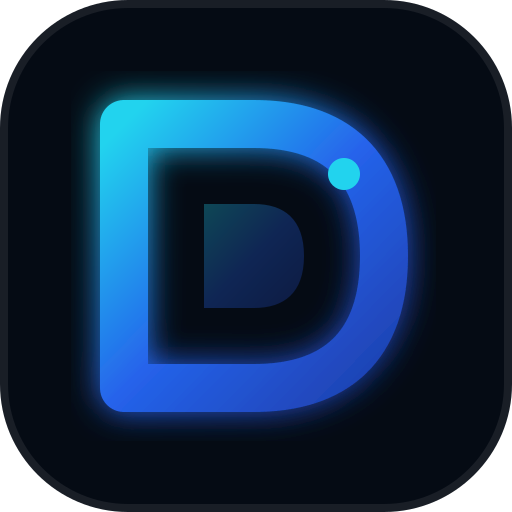

# DisTech — Digital Solution Technology
> **Website Company Profile Profesional & Modern untuk Jasa Pengembangan Website Mahasiswa**



---

## 📌 Tentag DisTech

**DisTech (Digital Solution Technology)** adalah penyedia jasa pengembangan website dan pendampingan project web terkhusus untuk mahasiswa (D3/S1 Informatika, Sistem Informasi, Manajemen Informatika, dll).

Website ini dibangun sebagai **Static Website** berperforma tinggi yang siap langsung di-deploy ke **Vercel** tanpa membutuhkan server backend maupun database.

---

## 🚀 Fitur Utama Website

1. **Sticky Transparent Navbar**:
   - Logo DisTech modern + tagline kecil.
   - Smooth backdrop blur saat scroll.
   - Mobile responsive drawer menu dengan animasi transisi.
   - Shortcut tombol langsung ke WhatsApp Konsultasi.

2. **Hero Section**:
   - Headline: *"BUILD YOUR PROJECT. WE MAKE IT DIGITAL."*
   - Interactive mockup UI dashboard dengan floating code card, live status indicators, dan subtle background glow.

3. **Intro Value Section**:
   - *"Project Website Jangan Berhenti di Tengah Jalan."*
   - 4 Card keunggulan utama (Modern Development, Project Focused, Responsive, Technical Support).

4. **Services Section (Layanan DisTech)**:
   - 5 Card Layanan:
     - 01. Website Development
     - 02. Feature Development (CRUD, Auth, API, Dashboard)
     - 03. Bug Fixing & Debugging
     - 04. UI/UX Design
     - 05. Project Consultation

5. **Portfolio Section with Category Filters**:
   - Filter Kategori: `All`, `Laravel`, `JavaScript`, `UI/UX`, `Website`.
   - Card project dilengkapi mockup visual web, teknologi badges, deskripsi, tombol **GitHub Repository**, dan **Live Demo**.
   - Data array terpisah di `src/data/portfolioData.js` agar mudah diubah.

6. **Why DisTech**:
   - 4 alasan memilih DisTech tanpa klaim statistik palsu.

7. **Workflow Timeline**:
   - Timeline 5 langkah (Konsultasi → Analisis → Development → Testing → Delivery).

8. **Pricing Options**:
   - 3 Card Paket (Starter, Business, Custom) dengan placeholder harga transparan.

9. **Accordion FAQ**:
   - 8 Pertanyaan yang sering diajukan lengkap dengan jawaban.

10. **CTA & Contact Channels**:
    - Direct integration ke WhatsApp (+62), Instagram (@distech.id), GitHub, dan Email (hello@distech.id).
    - Tombol copy-to-clipboard dengan indikator visual.

---

## 🛠️ Teknologi yang Digunakan

- **Vite** (Build tool super cepat)
- **React.js** (Framework UI modern & modular)
- **Tailwind CSS v4** (Design system dark mode premium: `#050B14`, Electric Blue `#2563EB`, Cyan `#22D3EE`)
- **Lucide React** (Ikon vektor modern)
- **HTML5 Semantic & SEO Meta Tags** (Favicon SVG, OpenGraph, robots.txt, sitemap.xml)

---

## ⚙️ Cara Menjalankan Project Secara Lokal

1. **Clone / Download Repository ini**:
   ```bash
   git clone https://github.com/USERNAME/distech-company-profile.git
   cd distech-company-profile
   ```

2. **Install Dependensi**:
   ```bash
   npm install
   ```

3. **Jalankan Development Server**:
   ```bash
   npm run dev
   ```
   Buka URL lokal yang muncul (biasanya `http://localhost:5173`).

4. **Build untuk Production**:
   ```bash
   npm run build
   ```
   Hasil build static akan dibuat di dalam folder `dist/`.

---

## 📂 Cara Mengubah Data & Konfigurasi (Customization)

Semua data teks, kontak, portfolio, harga, dan FAQ dipisahkan di folder `src/data/` agar mudah diedit tanpa mengubah kode UI:

- 📝 **`src/data/siteConfig.js`**:
  - Nomor WhatsApp, link Instagram, GitHub, Email
  - Paket Harga (Starter, Business, Custom)
  - Alasan & Workflow
- 📁 **`src/data/portfolioData.js`**:
  - Tambah / ubah project portfolio, badges teknologi, link GitHub, dan link Live Demo.
- ❓ **`src/data/faqData.js`**:
  - Tambah / ubah daftar pertanyaan FAQ.
- 🛠️ **`src/data/servicesData.js`**:
  - Ubah daftar layanan DisTech.

---

## 🌐 Instruksi Deployment ke Vercel

Website ini 100% statis dan sangat optimal di-deploy ke Vercel:

### Opsi 1: Deploy via Vercel CLI (Direkomendasikan)
1. Install Vercel CLI (jika belum):
   ```bash
   npm i -g vercel
   ```
2. Jalankan perintah deploy di folder project:
   ```bash
   vercel
   ```
3. Tekan Enter untuk menyetujui opsi bawaan.

### Opsi 2: Deploy via Dashboard Vercel (GitHub Integration)
1. Push repository ini ke akun **GitHub** Anda:
   ```bash
   git init
   git add .
   git commit -m "Initial commit for DisTech Company Profile"
   git remote add origin https://github.com/USERNAME/distech-company-profile.git
   git push -u origin main
   ```
2. Buka [Vercel Dashboard](https://vercel.com/dashboard) dan klik **"Add New"** > **"Project"**.
3. Hubungkan repository GitHub Anda.
4. Vercel akan otomatis mendeteksi **Vite**:
   - **Framework Preset**: Vite
   - **Build Command**: `npm run build`
   - **Output Directory**: `dist`
5. Klik **Deploy**! Website DisTech akan langsung live dalam beberapa detik dengan HTTPS aktif.

---

## 📄 Lisensi & Hak Cipta

© 2026 **DisTech (Digital Solution Technology)**. All rights reserved.
